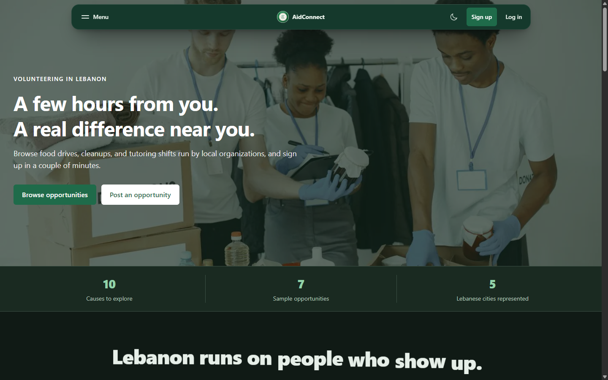
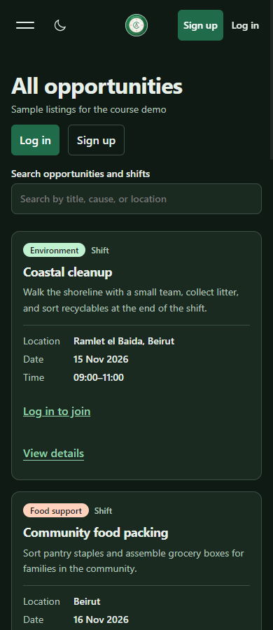
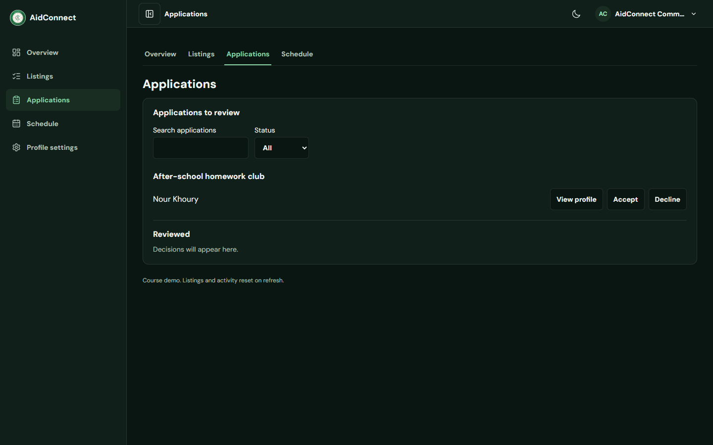

# AidConnect

AidConnect is a CSC443 Phase 1 frontend for volunteer coordination in Lebanon. Volunteers can discover opportunities, reserve shifts or apply for approval, and track their hours. Organizations can publish listings and manage applications and participants.

- **Team** JavaJunkies
- **Assigned topic** Volunteer Opportunity Board
- **Repository** [San-Tawil/web-programming-project](https://github.com/San-Tawil/web-programming-project)
- **Live demo** Add the public deployment URL here before submitting.

## Team and page ownership

Record two primary pages or views for each member. The suggested assignments below reflect the available project history. Update them to match your team's final allocation.

| Team member | Page or view 1 | Page or view 2 | Contributions |
| --- | --- | --- | --- |
| Hassan ElTawil | Homepage |Dashboards for both volunteers and organizations | Homepage content and responsive interactions, catalog browsing, dashboard workflows, and integration. |
| Melissa T. Mourad | Log in | Opportunity details | Login form and error feedback, session handling, and opportunity details and signup actions. |
| Adam M. Al Dayekh | _Add page or view_ | _Add page or view_ | _Add contributions_ |
| Tarek N. Kronfol | Sign up | Full-page posting form | Role-specific registration and the opportunity/shift posting flow. |

## Run locally

Use Node.js 22.12 or later with npm. From the folder containing `package.json`, run:

```bash
npm ci
npm run dev
```

Open the URL printed by Vite. No backend, API keys, or environment variables are required.

```bash
npm run lint
npm test
npm run build
npm run preview
```

The production build goes to `dist/`. Use the preview URL to try the production build locally.

## Try the demo

| Role         | Email                     | Demo password |
| ------------ | ------------------------- | ------------- |
| Volunteer    | `maya@example.com`        | `password123` |
| Organization | `team@aidconnect.example` | `password123` |

1. Visit **Opportunities** and search by title, cause, or location. Open a listing to see its details.
2. Sign in as the volunteer and open **Find shifts**. Reserve **Coastal cleanup** or apply for **After-school homework club**. See the result under **My shifts** or **Applications**.
3. In the same browser tab, log out and sign in as the organization. Open **Applications** to review requests and view volunteer profiles. Under **Listings → Participants**, select a confirmed participant’s name to open their profile.
4. Open **Listings → Open full posting form** to create an opportunity or shift. Use **My opportunities** to edit, close, or delete an opportunity.
5. Open volunteer **Profile settings** to edit contact details, a bio, and tags, or attach a CV. Use **Hours & planning** to log hours and estimate planned time.

## Views and entities

| View                                  | Route or entry point                                                                    |
| ------------------------------------- | --------------------------------------------------------------------------------------- |
| Homepage                              | `/`                                                                                     |
| Opportunity catalog                   | `/opportunities`                                                                        |
| Opportunity or shift details          | `/opportunities/:id`                                                                    |
| Volunteer profile details             | **View profile** under organization Applications or select a participant under Listings |
| Add or edit listings                  | `/organizations/opportunities/new` to post, or **Edit** under organization Listings     |
| Volunteer and organization dashboards | `/volunteer/dashboard` and `/organizations/dashboard`                                   |
| Login                                 | `/login`                                                                                |
| Registration                          | `/register`                                                                             |
| About and Contact                     | `/about` and `/contact`                                                                 |

The primary entities are **volunteers**, **organizations**, **opportunities**, **shifts**, and **applications or reservations**. An organization owns its listings. A shift can stand alone or belong to an opportunity. Volunteer profiles also track availability-related activity through hours and planned shifts, and organizers can rate confirmed volunteers.

## Mock data and accessibility

`src/data/dashboardDemo.js` seeds listings, signups, and completed-shift examples. A shared React reducer applies posting, editing, closing, deleting, reservation, and application-review changes immediately. Listings, applications, ratings, and activity reset on refresh. Registered demo accounts and text profile edits use browser storage, while photos and CVs are temporary. The Contact form demonstrates validation and confirmation without delivering messages.

The app uses React, React Router, Tailwind CSS, and Vite. It includes semantic landmarks, labeled controls, a keyboard skip link, visible focus, status announcements, and reduced-motion behavior. React Bits supplied animation and navigation components, and photo credits appear on the site. [React Bits](https://reactbits.dev/)

## Screenshots

### Homepage



### Mobile opportunities catalog



### Organization application review


