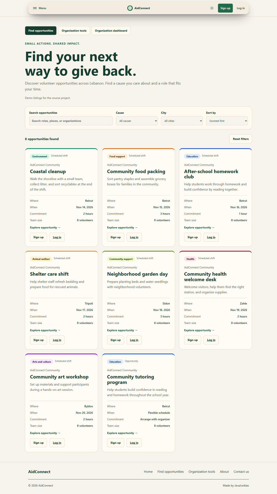
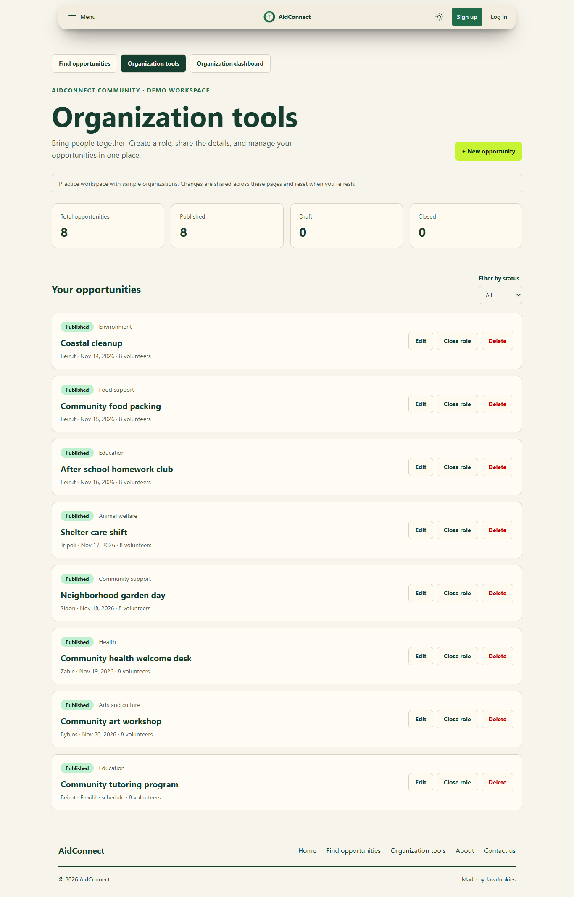
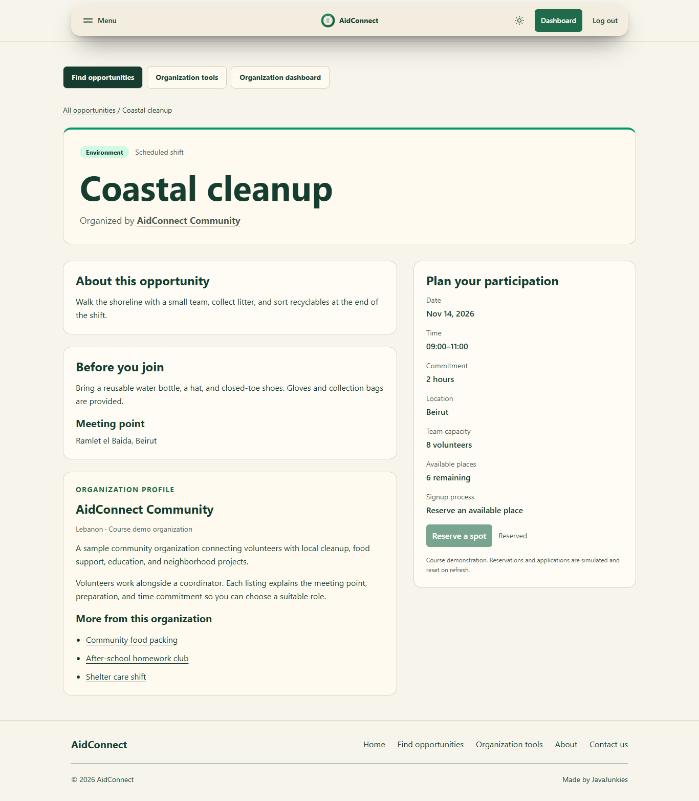

# web-programming-project
Credits: [React Bits](https://reactbits.dev/) supplied the visual effects and navigation components.

## Project structure

The app source lives under `src/`.

- `src/index.html` is the single HTML entry. `src/main.jsx` starts React and defines the routes.
- `src/pages/` holds the route views, and `src/components/` holds shared components. React Bits effects and their styles live together in `src/components/fx/`.
- `src/styles/index.css` holds Tailwind's theme, shared defaults, and animation definitions. Page and component styles use Tailwind classes in JSX.
- `src/assets/`, `src/context/`, and `src/hooks/` hold images, shared state, and hooks.

Run `npm run dev`, `npm run build`, or `npm run preview` from the project folder. Vite writes the production site to `dist/`.

## How the app works

- `src/main.jsx` contains the page routes and shows a skeleton while a page loads.
- `AuthActions.jsx` supplies the same Sign up and Log in links on desktop and mobile. Both routes use `AccountPage.jsx` for the placeholders.
- `ThemeSwitch.jsx` flips a single dark-mode setting. Tailwind's `dark:` classes change the colors, and the browser remembers the choice.
- `DeferredContent.jsx` waits until a homepage effect is close to view before loading it.

### Dashboard demo

Open `/volunteer/dashboard` or `/organizations/dashboard` from the account placeholders. Reserve the coastal cleanup for instant signup, or apply to the homework club and accept the application from the organization dashboard. Both pages use the same in-memory demo data. Refreshing resets the demo. The hours chart uses sample data.

Organizations can add an undated opportunity or a scheduled shift. Shifts can stand alone or be attached to an opportunity. The dashboard reads the greeting and listing ownership from the demo account, so login can supply the same account fields in Phase 2.

## React Bits handoff

The app already had GSAP. ScrollReveal uses its bundled ScrollTrigger plugin, and BubbleMenu uses GSAP for its opening transition. This integration adds no dependencies.

### Added or changed

- `src/components/fx/` contains CardNav and the effect pairs. The full modified BubbleMenu is in `src/components/fx/BubbleMenu/BubbleMenu.jsx`.
- The theme provider and hooks connect the navigation and homepage components to the selected theme.
- `src/assets/` is the source image folder. `brand/` holds AidConnect branding, `photos/` holds stock photography, and `logos/` holds the three available platform marks. The Volunteer Circle and Takatof use wordmarks.
- `src/components/fx/GradientASCII/NotFoundEffect.jsx` and its CSS are the ready-to-use 404 view. The existing 404 route stays with its owner.

### Vendor modifications

ScrollExpand changes its visual title and hint from ordinary divs to decorative divs.

```diff
- <div ref={titleRef} className="scroll-expand__title">
+ <div aria-hidden="true" ref={titleRef} className="scroll-expand__title">
- <div ref={hintRef} className="scroll-expand__hint">
+ <div aria-hidden="true" ref={hintRef} className="scroll-expand__hint">
```

`// MODIFIED(1)` The overlay h2 supplies the accessible heading.

```diff
+ overlayRef.current.inert = inn < 0.6; // MODIFIED(2)
- <div ref={overlayRef} className="scroll-expand__overlay">
+ <div inert="" ref={overlayRef} className="scroll-expand__overlay">
```

BubbleMenu's eight numbered modifications are marked in the full file. LogoLoop, ScrollReveal, PixelTrail, and GradientASCII use their existing APIs. Each vendor stylesheet is wrapped in `@layer components`, before the utilities layer. The theme provider applies the root class in `useLayoutEffect`. The color hook observes that class and reads the computed values after it changes.

### Usage for page owners

- **404** — Import and render `NotFoundEffect` from `../components/fx/GradientASCII/NotFoundEffect.jsx` in `src/pages/NotFoundPage.jsx`. It already contains the page heading, Home link, fallback card, and lazy canvas.
- **About** — Use ScrollReveal for one actual h2, with plain text and an accessible fallback heading. If using GradientASCII in an optional header, place copy on a solid surface and keep that route to one WebGL effect.
- **404 PixelTrail alternative** — Use the same reduced-motion and fine-pointer gate as `OrganizationTrail` in `src/components/HomeExtras.jsx`. Use it in place of GradientASCII to keep one canvas.
- **Dashboard** — No decorative effects are needed.

The existing photo hero is shared by both themes in this checkout. The Home update preserves that layout. The paused and reduced-motion platform strips use a wrapped list to keep all links reachable. Logo assets remain named by slug and load through the Vite glob.

## Opportunity list and organization tools (Phase 1)

- `/opportunities`: searchable published listings; combined cause/city filters; date, duration, and title sorting; result counts, reset and empty states; cause-colored cards linking to full opportunity details.
- `/organizations/tools`: AidConnect Community's demo workspace; create and edit validated opportunities; draft/published/closed states; deletion with confirmation; live counts and status filtering.
- Desktop, mobile and footer navigation link to the tools. The homepage's featured cards use the same shared data.

### Run locally

Use Node.js 22.12+ (or 20.19+), then run `npm ci` and `npm run dev` from the repository root. Open the URL Vite prints and visit the routes above. `npm run build` creates `dist/`; `npm run preview` serves that build. Production hosting must rewrite application routes to `index.html` for BrowserRouter deep links.

### Data and course alignment

`DashboardDemoProvider` owns one in-memory reducer store for opportunities, shifts, and signups. `OpportunitiesProvider` adapts organization tools to that same store; the list, homepage, and both dashboards share changes. `src/data/opportunities.js` supplies preparation details and city metadata for the seed records. Navigation preserves changes; refreshing restores the seed data. Organization identity is fixed for this Phase 1 demonstration, not authenticated access control. No real opportunities are published and no backend requests are sent.

The list covers the brief's List View; organization tools covers the Add/Edit Form and mock CRUD. Shared components receive props, controlled forms validate text/date/numeric inputs, and `useEffect` updates page titles. Semantic sections/articles, heading order, labels, time elements, linked validation messages, live feedback, keyboard focus and native dialog behavior follow Chapters 3–4. Responsive Grid/Flexbox, theme variables, Tailwind utilities and breakpoints follow Chapters 5–8. Events, conditional display, array filtering/mapping and immutable object updates apply Chapters 9–10 through React.

These two pages do not by themselves satisfy the whole team's submission: the brief separately requires two distinct detail routes, login/register, other assigned views, team names/contribution attribution, deployment and screenshots. Expandable listing details are not claimed as separate detail pages.

### Manual acceptance walkthrough

1. Filter opportunities by Education and Beirut; search for homework. Reset and try an unmatched search, then open a card by clicking its body or focusing its title and pressing Enter.
2. Open Organization tools. Create an empty role to see labeled validation errors; enter valid fields and choose Published.
3. Navigate to Find opportunities and search for the new title. Open its details.
4. Return to tools, edit the title, then close the role. Confirm it disappears from the public list. Publish again to restore it.
5. Delete it; cancel once to verify it remains, then confirm. Refresh to restore the sample data.
6. Repeat at mobile/tablet/desktop widths, in light/dark mode, and using the keyboard.

### Page previews and verification




Verified with a production build and Chromium interaction checks: combined filters, empty results, detail disclosure, continuous search typing, required-field validation, create/edit, cross-route data sharing, publish/close, deletion cancellation/confirmation, and no horizontal overflow at 320, 390, 768 and 1366 pixels. Light and dark layouts were reviewed. Vite was aligned to version 7 to match the existing plugins' supported peer dependency range.


### Main integration

Merged main's registration, login, role toggle, volunteer dashboard and organization dashboard. Both creation forms remain available: the dashboard creates programs and scheduled shifts; tools edit visibility and listing details. Published records can be joined/applied to from the searchable list. Closing a parent hides its shifts from public discovery; deleting it removes its shifts and associated signups. Capacity edits cannot undercut confirmed reservations. Ongoing programs may omit date and hours. New records use unique IDs even after deletions.

About, Contact and Not Found now explicitly import React, fixing route crashes under the existing Vite JSX configuration. Contact remains the team's existing frontend placeholder; it does not send messages.

Integration verification: `node --test tests/opportunities.test.js` covers capacity limits, unique IDs after deletion, schedule updates, parent visibility and cascading deletion. Production-browser checks cover signup/approval, both registration/login roles, cross-page creation and editing, responsive routes and errors. Role-specific login links now open the working login form.


### Opportunity discovery and details

Cards use shared cause colors with visible text labels, so color is not the only cue. Hover and keyboard focus highlight cards; a real React Router link opens `/opportunities/:opportunityId`. Separate signup/login controls remain independently keyboard accessible. The detail page includes preparation guidance, timing, availability, related shifts, and a labeled organization profile with demo data. Missing, closed or draft IDs show an unavailable state.

Guests see Sign up and Log in instead of reservation/application buttons. Logged-in volunteers can reserve/apply; organization accounts receive an explanation. The shared context also rejects guest join actions. Login and registration return volunteers to the selected opportunity through a restricted internal return path. This remains Phase 1 mock authentication, with session identity reset on page refresh.

Both pages use existing React hooks, React Router, and Tailwind theme utilities. Headings, landmarks, breadcrumbs, visible labels, focus indicators, reduced-motion support and live availability feedback provide accessible navigation. Run `node --test tests/*.test.js` for the reducer and return-path checks.



Verified: production build; six Node tests; guest/volunteer/organization action visibility; card click and keyboard navigation; login/signup return paths; unavailable IDs; and 320/390/768/1366-pixel layouts. Automated axe checks of the list and both scheduled/flexible detail variants reported no WCAG 2 A/AA or 2.1 AA violations in the page main content in either theme. Automated checks complement the keyboard and visual review; they do not establish complete accessibility conformance.
