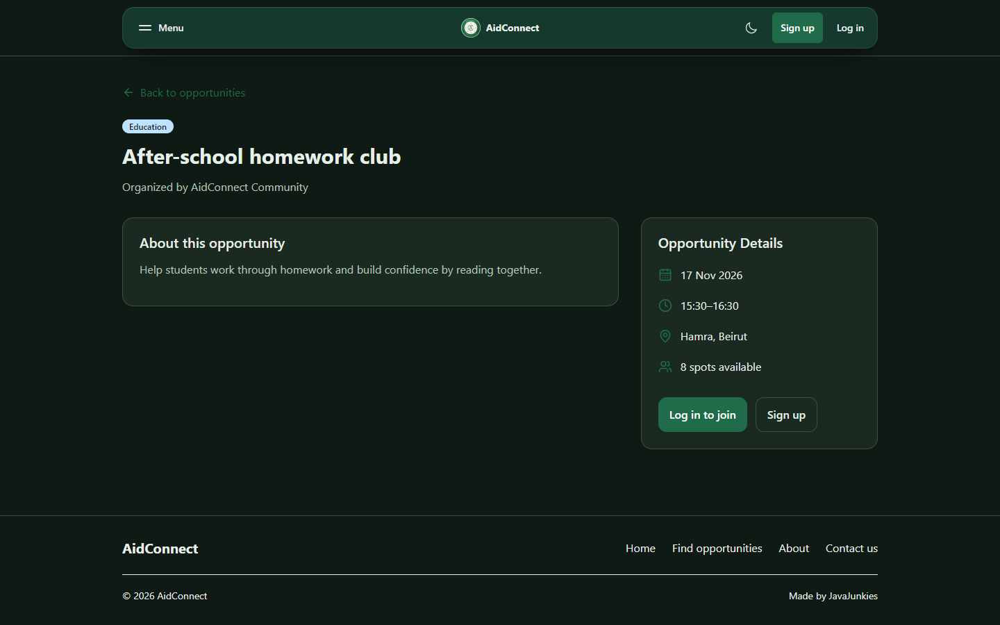
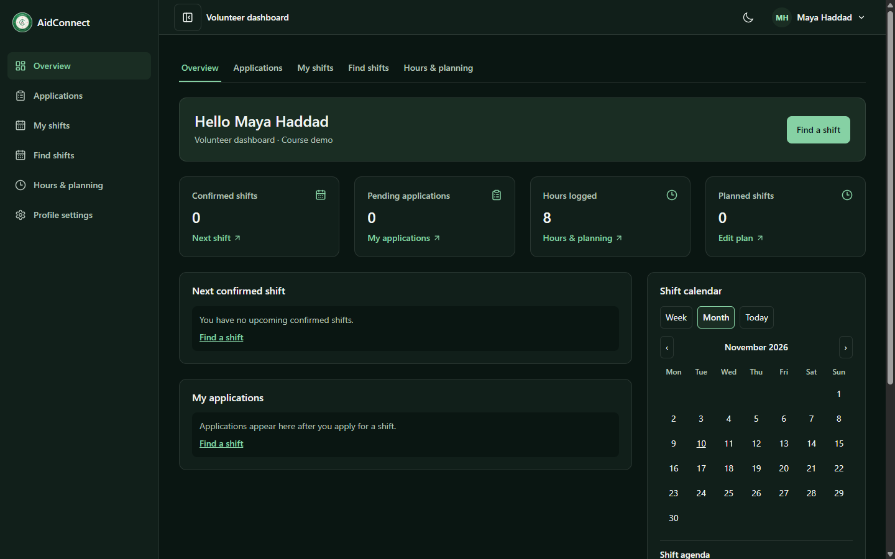
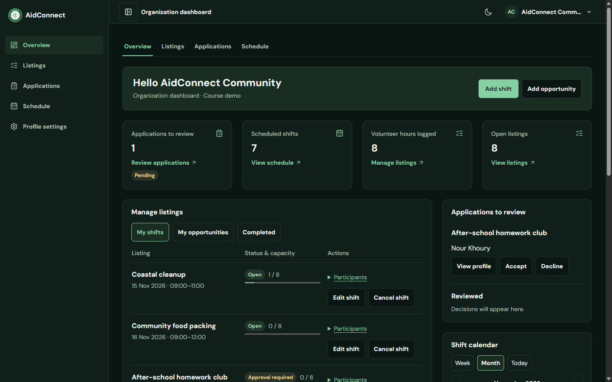

# AidConnect

AidConnect is a CSC443 Phase 1 frontend for volunteer coordination in Lebanon. Volunteers can discover opportunities, reserve shifts or apply for approval, and track their hours. Organizations can publish listings and manage applications and participants.

- **Team** JavaJunkies
- **Assigned topic** Volunteer Opportunity Board
- **Repository** [San-Tawil/web-programming-project](https://github.com/San-Tawil/web-programming-project)
- **Live demo** [AidConnect](https://aid-connect-web.vercel.app/)

## Team and page ownership

Record two primary pages or views for each member. The suggested assignments below reflect the available project history. Update them to match your team's final allocation.

 aid-connect-final
| Team member | Page or view 1 | Page or view 2 | Contributions |
| --- | --- | --- | --- |
| Hassan ElTawil | Homepage | Volunteer and organization dashboards | Led homepage development and built workflows for both dashboards. Also worked on the opportunities catalog, contributed to login and registration, and integrated the final project changes. |
| Melissa T. Mourad | Log in | Opportunity details | Login form and error feedback, session handling, and opportunity details and signup actions. |
| Adam M. Al Dayekh | _Add page or view_ | _Add page or view_ | _Add contributions_ |
| Tarek N. Kronfol | Sign up | Full-page posting form | Role-specific registration and the opportunity/shift posting flow. |

## Run locally

Use Node.js 22.12 or later with npm. From the folder containing `package.json`, run:

```bash
npm ci
npm run dev
```

Open the URL printed by Vite. No backend, API keys, or environment variables are required.

```bash
npm run lint
npm test
npm run build
npm run preview
```

The production build goes to `dist/`. Use the preview URL to try the production build locally.

## Try the demo

| Role         | Email                     | Demo password |
| ------------ | ------------------------- | ------------- |
| Volunteer    | `maya@example.com`        | `password123` |
| Organization | `team@aidconnect.example` | `password123` |

1. Visit **Opportunities** and search by title, cause, or location. Open a listing to see its details.
2. Sign in as the volunteer and open **Find shifts**. Reserve **Coastal cleanup** or apply for **After-school homework club**. See the result under **My shifts** or **Applications**.
3. In the same browser tab, log out and sign in as the organization. Open **Applications** to review requests and view volunteer profiles. Under **Listings → Participants**, select a confirmed participant’s name to open their profile.
4. Open **Listings → Open full posting form** to create an opportunity or shift. Use **My opportunities** to edit, close, or delete an opportunity.
5. Open volunteer **Profile settings** to edit contact details, a bio, and tags, or attach a CV. Use **Hours & planning** to log hours and estimate planned time.

## Views and entities

| View                                  | Route or entry point                                                                    |
| ------------------------------------- | --------------------------------------------------------------------------------------- |
| Homepage                              | `/`                                                                                     |
| Opportunity catalog                   | `/opportunities`                                                                        |
| Opportunity or shift details          | `/opportunities/:id`                                                                    |
| Volunteer profile details             | **View profile** under organization Applications or select a participant under Listings |
| Add or edit listings                  | `/organizations/opportunities/new` to post, or **Edit** under organization Listings     |
| Volunteer and organization dashboards | `/volunteer/dashboard` and `/organizations/dashboard`                                   |
| Login                                 | `/login`                                                                                |
| Registration                          | `/register`                                                                             |
| About and Contact                     | `/about` and `/contact`                                                                 |

The primary entities are **volunteers**, **organizations**, **opportunities**, **shifts**, and **applications or reservations**. An organization owns its listings. A shift can stand alone or belong to an opportunity. Volunteer profiles also track availability-related activity through hours and planned shifts, and organizers can rate confirmed volunteers.

## Mock data and accessibility

`src/data/dashboardDemo.js` seeds listings, signups, and completed-shift examples. A shared React reducer applies posting, editing, closing, deleting, reservation, and application-review changes immediately. Listings, applications, ratings, and activity reset on refresh. Registered demo accounts and text profile edits use browser storage, while photos and CVs are temporary. The Contact form demonstrates validation and confirmation without delivering messages.

The app uses React, React Router, Tailwind CSS, and Vite. It includes semantic landmarks, labeled controls, a keyboard skip link, visible focus, status announcements, and reduced-motion behavior. React Bits supplied animation and navigation components, and photo credits appear on the site. [React Bits](https://reactbits.dev/)

## Challenges and how we addressed them

- **Combining overlapping branch changes.** The posting form and opportunity details branches both touched routing and the organization dashboard. We integrated the full-page form and the newer details and login improvements while keeping the working signup routes and participant profiles.
- **Keeping volunteer and organization actions separate.** Both roles use the same demo state, but their workflows differ. We matched listings to organization IDs, limited organizers to their own listings, and kept volunteer reservations and applications in the volunteer flow.
- **Keeping opportunities and shifts consistent.** A shift can belong to a larger opportunity or stand alone. We added checks for dates and capacity, and made linked shifts standalone when their parent opportunity is deleted so those shifts remain available.
- **Improving mobile layout and keyboard navigation.** We found that the opportunity details page inherited the dashboard's scroll lock and that some homepage effects were disabled on small screens. We limited the scroll lock to dashboards, adapted the effects for mobile, and checked the keyboard skip link at desktop and mobile widths.
- **Supporting direct links after deployment.** React Router handles navigation in the browser. We added a Vercel rewrite so opening or refreshing a URL loads the app and reaches the correct page.

## Screenshots

### Homepage


### Mobile opportunities catalog


### Organization application review


### Opportunities catalog on desktop


### Opportunity details



### Volunteer dashboard



### Organization dashboard




## Opportunity list and organization tools (Phase 1)

- `/opportunities`: searchable published listings; combined cause/city filters; date, duration, and title sorting; result counts, reset and empty states; cause-colored cards linking to full opportunity details.
- `/organizations/tools`: AidConnect Community's demo workspace; create and edit validated opportunities; draft/published/closed states; deletion with confirmation; live counts and status filtering.
- Desktop, mobile and footer navigation link to the tools. The homepage's featured cards use the same shared data.

### Run locally

Use Node.js 22.12+ (or 20.19+), then run `npm ci` and `npm run dev` from the repository root. Open the URL Vite prints and visit the routes above. `npm run build` creates `dist/`; `npm run preview` serves that build. Production hosting must rewrite application routes to `index.html` for BrowserRouter deep links.

### Data and course alignment

`DashboardDemoProvider` owns one in-memory reducer store for opportunities, shifts, and signups. `OpportunitiesProvider` adapts organization tools to that same store; the list, homepage, and both dashboards share changes. `src/data/opportunities.js` supplies preparation details and city metadata for the seed records. Navigation preserves changes; refreshing restores the seed data. Organization ownership follows main's active account and isolates newly registered organizations from the seed listings. No real opportunities are published and no backend requests are sent.

The list covers the brief's List View; organization tools covers the Add/Edit Form and mock CRUD. Shared components receive props, controlled forms validate text/date/numeric inputs, and `useEffect` updates page titles. Semantic sections/articles, heading order, labels, time elements, linked validation messages, live feedback, keyboard focus and native dialog behavior follow Chapters 3–4. Responsive Grid/Flexbox, theme variables, Tailwind utilities and breakpoints follow Chapters 5–8. Events, conditional display, array filtering/mapping and immutable object updates apply Chapters 9–10 through React.

These two pages do not by themselves satisfy the whole team's submission: the brief separately requires two distinct detail routes, login/register, other assigned views, team names/contribution attribution, deployment and screenshots. Expandable listing details are not claimed as separate detail pages.

### Manual acceptance walkthrough

1. Filter opportunities by Education and Beirut; search for homework. Reset and try an unmatched search, then open a card by clicking its body or focusing its title and pressing Enter.
2. Open Organization tools. Create an empty role to see labeled validation errors; enter valid fields and choose Published.
3. Navigate to Find opportunities and search for the new title. Open its details.
4. Return to tools, edit the title, then close the role. Confirm it disappears from the public list. Publish again to restore it.
5. Delete it; cancel once to verify it remains, then confirm. Refresh to restore the sample data.
6. Repeat at mobile/tablet/desktop widths, in light/dark mode, and using the keyboard.

### Page previews and verification


Verified with a production build and Chromium interaction checks: combined filters, empty results, detail disclosure, continuous search typing, required-field validation, create/edit, cross-route data sharing, publish/close, deletion cancellation/confirmation, and no horizontal overflow at 320, 390, 768 and 1366 pixels. Light and dark layouts were reviewed. Vite was aligned to version 7 to match the existing plugins' supported peer dependency range.


### Main integration

Merged main's registration, login, role toggle, volunteer dashboard and organization dashboard. Both creation forms remain available: the dashboard creates programs and scheduled shifts; tools edit visibility and listing details. Published records can be joined/applied to from the searchable list. Closing a parent hides its shifts from public discovery; deleting it removes its shifts and associated signups. Capacity edits cannot undercut confirmed reservations. Ongoing programs may omit date and hours. New records use unique IDs even after deletions.

About, Contact and Not Found now explicitly import React, fixing route crashes under the existing Vite JSX configuration. Contact remains the team's existing frontend placeholder; it does not send messages.

Integration verification: `node --test tests/opportunities.test.js` covers capacity limits, unique IDs after deletion, schedule updates, parent visibility and cascading deletion. Production-browser checks cover signup/approval, both registration/login roles, cross-page creation and editing, responsive routes and errors. Role-specific login links now open the working login form.


### Opportunity discovery and details

Cards use shared cause colors with visible text labels, so color is not the only cue. Hover and keyboard focus highlight cards; a real React Router link opens `/opportunities/:opportunityId`. Separate signup/login controls remain independently keyboard accessible. The detail page includes preparation guidance, timing, availability, related shifts, and a labeled organization profile with demo data. Missing, closed or draft IDs show an unavailable state.

Guests see Sign up and Log in instead of reservation/application buttons. Logged-in volunteers can reserve/apply; organization accounts receive an explanation. The shared context also rejects guest join actions. Login and registration return volunteers to the selected opportunity through a restricted internal return path. This remains Phase 1 mock authentication, with main's remembered-email and session/local storage behavior preserved.

Both pages use existing React hooks, React Router, and Tailwind theme utilities. Headings, landmarks, breadcrumbs, visible labels, focus indicators, reduced-motion support and live availability feedback provide accessible navigation. Run `node --test tests/*.test.js` for the reducer and return-path checks.


Verified: production build; six Node tests; guest/volunteer/organization action visibility; card click and keyboard navigation; login/signup return paths; unavailable IDs; and 320/390/768/1366-pixel layouts. Automated axe checks of the list and both scheduled/flexible detail variants reported no WCAG 2 A/AA or 2.1 AA violations in the page main content in either theme. Automated checks complement the keyboard and visual review; they do not establish complete accessibility conformance.


## Local combined review - 2026-11-11

This local review combines `opportunity-list/organization-details` at `50a967c` with main at `06e2dc5` on `review/opportunities-main`. Nothing from this review has been pushed or merged on GitHub.

- Main's dashboard navigation, participant profiles/ratings, profile settings, shift edits/cancellations, hours/planning, scheduled posting forms, Contact confirmation, and persistent sessions remain available.
- The searchable, cause-colored catalog, guest signup/login return paths, and `/organizations/tools` remain available. The main detail route `/opportunities/:id` combines main's reservation/withdrawal confirmation and dashboard return navigation with the organization profile and volunteer guidance. The earlier overview is retained at `/opportunities/:opportunityId/organization`.
- Main's `OpportunityForm` remains the dashboard/full-page form; `OrganizationOpportunityForm` is the tools editor. Both use the same reducer and schedule/capacity validation.
- Dashboard program deletion keeps linked shifts standalone, as main specifies. Tools deletion explicitly confirms removing linked shifts and signups. Dashboard closure retains linked shifts; tools visibility can hide a program and its linked shifts. These actions keep their respective confirmation behavior.
- New sessions and saved text profiles use main's browser storage. Demo listings, reservations, applications and logged hours still reset on refresh.

To review, run `npm.cmd run dev` and open Vite's local URL. Use `npm.cmd run lint`, `npm.cmd test`, and `npm.cmd run build` for checks. A local merge commit can be reviewed independently of the published branch.


Review previews: [Combined catalog](docs/screenshots/combined-catalog.png), [Combined detail](docs/screenshots/combined-detail.png), [Dashboard](docs/screenshots/combined-dashboard.png), [Organization tools](docs/screenshots/combined-tools.png). Main's earlier catalog screenshot is retained as `docs/screenshots/opportunities-main.png`.

Integration checks passed: lint, 13 Node tests, production build, and production browser flows covering reservations/cancellation, applications/approval, remembered sessions, profile persistence, posting/editing/cancelling shifts, tools CRUD, organization isolation, and desktop/mobile routes.
